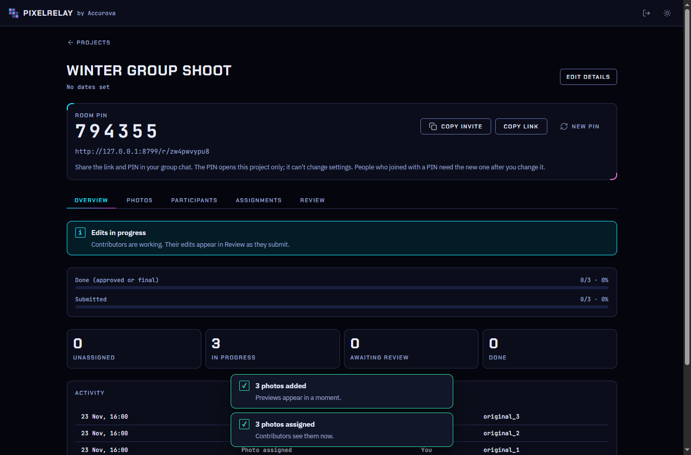
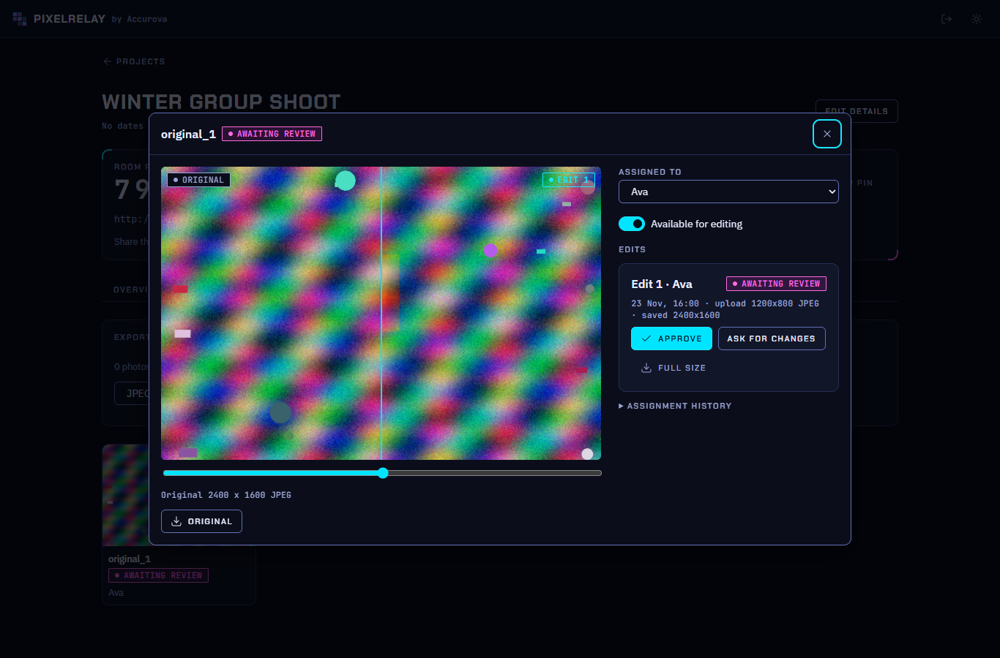
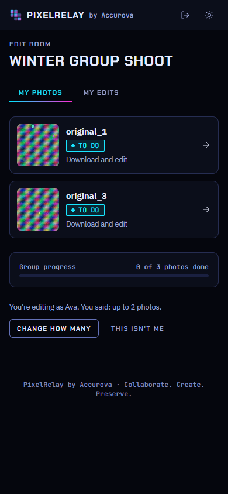
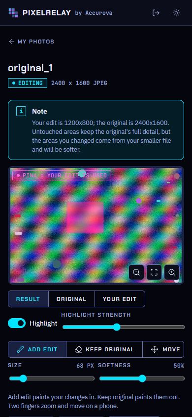

# PixelRelay by Accurova

**Every edit moves the picture forward.** Collaborate. Create. Preserve.

PixelRelay coordinates group photo editing. A photographer or organiser shares out the photos from a group shoot. Each contributor (often a cosplayer) downloads their originals, edits them in any app, and uploads the export. **Smart Merge** works out what they changed and puts those changes back onto the full-resolution original. Every original, upload, mask and composite is kept. The owner reviews, approves, picks final versions and exports them.

Contributors don't need an account. They open the project link, enter the six-digit **Room PIN** and pick their name.

| Owner overview | Review and compare | Contributor on a phone | Smart Merge editor |
|---|---|---|---|
|  |  |  |  |

## Quick start

Needs Python 3.12+.

```bash
python -m venv .venv
.venv/Scripts/pip install -r requirements-dev.txt      # Windows; on macOS/Linux use .venv/bin/
.venv/Scripts/python -m pixelrelay                     # http://127.0.0.1:8000
```

With no `.env`, it runs in development mode: **dev sign-in** (any email, no check; refused in production), data in `./data`, and the image worker in a background thread. Open `/login`, create a project, add photos, then open the room link in a private window to act as a contributor.

## The journey

1. **Owner:** sign in, create a project (name, optional dates, participant names), upload originals.
2. **Owner:** opt people in (or let them choose how many they can edit), **preview an even split**, adjust, **publish**. Share the link and Room PIN in the group chat.
3. **Contributor:** open link, enter PIN, pick name, see only **their** photos.
4. **Contributor:** download the original, edit anywhere, upload the export.
5. **Smart Merge** aligns the export to the original, detects changes (Low/Medium/High), and opens the editor. The contributor refines the mask with **Add edit / Keep original** brushes, checks Result/Original/Your edit, and submits.
6. The server composites **at the original's full resolution**; untouched areas keep the original pixels exactly.
7. **Owner:** compare original and edit, **approve** or **ask for changes** (the contributor sees the note), **choose the final version**, **export finals** as a ZIP.

Contributors can reopen any of their submissions and create a new edit; nothing is overwritten.

## Architecture

```
Browser (vanilla JS modules, no build step)
  owner app /owner · contributor app /r/{slug} · merge editor (canvas, work size <= 2048 px)
        │ JSON + multipart, cookie sessions, X-PixelRelay CSRF header
        ▼
FastAPI (pixelrelay/)
  access.py     centralised authorisation (owner sessions, room sessions, file access)
  api_*.py      routes: auth, owner, room
  services.py   domain operations and state transitions
  jobs.py       durable job queue in the database + handlers (worker thread or separate process)
  merge.py      Smart Merge: alignment, difference mask, full-res compositing (numpy + Pillow)
  storage.py    write-once storage: local disk or Cloudflare R2 (S3 API, stdlib signing)
  db.py         one small API over SQLite and Postgres
        │
local:       SQLite (data/pixelrelay.sqlite3)  ·  files (data/files/...)
production:  Postgres schema accurova_pixelrelay (shared Supabase)  ·  R2 bucket accurova-pixelrelay
```

In production the app runs as a Cloudflare Container behind a small Worker ([cloudflare/worker.js](cloudflare/worker.js)), at `https://pixelrelay.accurova.com`. The container keeps nothing on its own disk. See [decision D12](docs/decisions/README.md).

More: [architecture](docs/architecture.md) · [security](docs/security.md) · [image processing](docs/image-processing.md) · [decisions](docs/decisions/README.md) · [status and limitations](docs/implementation-status.md) · [original brief](docs/product-requirements.md).

## Configuration

Everything is in [.env.example](.env.example). The essentials:

| Variable | Development | Production |
|---|---|---|
| `APP_ENV` | `development` | `production` (enforces the checks below) |
| `BASE_URL` | `http://localhost:8000` | `https://…` (required) |
| `SECRET_KEY` | auto-generated into `DATA_DIR/.dev-secret` | 48+ random chars (required) |
| `AUTH_MODE` | `dev` | `supabase` + `SUPABASE_URL`, `SUPABASE_ANON_KEY` |
| `OWNER_EMAILS` | empty (anyone) | the organisers' emails |
| `DATABASE_URL` | empty (SQLite in `DATA_DIR`) | the `accurova_pixelrelay_app` role's Supabase pooler URL |
| `STORAGE_PROVIDER` | `local` | `r2` + `R2_ENDPOINT`, `R2_BUCKET`, `R2_ACCESS_KEY_ID`, `R2_SECRET_ACCESS_KEY` |
| `DATA_DIR` | `data` | unused on Cloudflare; a persistent volume anywhere else |
| `WORKER_MODE` | `thread` | `thread`, or `off` plus `python -m pixelrelay.worker` |

On Cloudflare the non-secret values are in [wrangler.jsonc](wrangler.jsonc) `vars` and the rest are Worker secrets.

### Supabase Auth (owner sign-in)

1. In the Supabase project: Authentication → Providers → Email: enable, magic link on.
2. Authentication → URL configuration: add `https://<your host>/auth/callback` to the redirect allow-list.
3. Set `AUTH_MODE=supabase`, `SUPABASE_URL`, `SUPABASE_ANON_KEY`, `OWNER_EMAILS`.

Owners sign in through the shared `thebooleanjulian` Supabase project. PixelRelay's data is in that project's `accurova_pixelrelay` schema, applied from [thebooleanjulian-db](https://github.com/TheBooleanJulian/thebooleanjulian-db). The app connects as a role that can read and write rows but can't change the schema.

## Tests and checks

```bash
.venv/Scripts/ruff check . && .venv/Scripts/ruff format --check .
.venv/Scripts/python -m pytest -q            # 61 tests on SQLite + local files (Postgres-only tests skip)
# production-like: Postgres as the app role + the R2 adapter against an in-memory S3 server
PIXELRELAY_TEST_PG_ADMIN_URL=postgresql://postgres:…@localhost/postgres PIXELRELAY_TEST_STORAGE=r2 .venv/Scripts/python -m pytest -q
node tests/e2e/journey.mjs                   # whole journey in headless Edge/Chrome (owner desktop + contributor phone)
SCREENSHOTS=docs/screenshots node tests/e2e/journey.mjs   # refresh the README screenshots
```

| Suite | Covers |
|---|---|
| `tests/test_merge.py` | low-res JPEG export → local mask, no false positives, canvas size kept, untouched pixels identical, sensitivity order, rotated / cropped / shifted / unrelated / reshaped exports, EXIF orientation, bad files |
| `tests/test_distribution.py` | balanced split, capacity, opt-in, existing load, priority, determinism |
| `tests/test_api.py` | PIN creation and storage, join without email, remembered and revoked devices, PIN rotation, single-use invitations, rate limiting, CSRF, owner-only functions, file authorisation, parallel editing, reassignment history, full revision journey, immutability (DB triggers + write-once storage), blocked alignment, progress |
| `tests/test_storage.py` | R2 request signing (AWS's published example), write-once PUT, missing files, bad keys, retries |
| `tests/test_db.py` | placeholder rewriting, row access, rollback, clear error without the schema, `SKIP LOCKED` job claims |
| `tests/e2e/journey.mjs` | the main journey in a real browser, with zero console errors |

CI (`.github/workflows/ci.yml`) runs lint and pytest, then pytest again on Postgres 16 as the app role with files going through the R2 adapter. It also runs the browser journey, builds and boots the Docker image, and does a `wrangler deploy --dry-run`.

## Deployment

**Cloudflare (production):** every push to `main` runs [.github/workflows/deploy.yml](.github/workflows/deploy.yml). It builds the image from the [Dockerfile](Dockerfile) and deploys the Worker and the Container with `wrangler deploy`. `main` only changes through the `dev → main` PR. The one-time setup (database schema, R2 bucket, secrets, Supabase redirect URL) is a step-by-step checklist in [progress.md](progress.md).

- Logs: `npx wrangler@4.152.0 tail accurova-pixelrelay`, or Workers → accurova-pixelrelay → Logs.
- Health: `https://pixelrelay.accurova.com/healthz` answers `"database": "postgres", "storage": "r2"`. The first request after 15 idle minutes waits for the container to start.
- Roll back: Workers → accurova-pixelrelay → Deployments → pick the previous version. The database schema is additive, so older code still runs on it.

**Any other container host:** the same image runs on SQLite and local files.

```bash
docker build -t accurova-pixelrelay .
docker run -p 8000:8000 -v pixelrelay-data:/data --env-file .env accurova-pixelrelay
```

Back up the `/data` volume in that setup: it holds the database and every image.

## Project layout

```
pixelrelay/           app package (see Architecture)
  migrations/         SQLite migrations (applied at start-up); postgres/ = copy of the thebooleanjulian-db schema
  web/                HTML shells + static/css (Unified UI tokens) + static/js
tests/                pytest suites, synthetic fixtures, e2e/ browser journey
docs/                 architecture, security, image processing, decisions, status, screenshots
cloudflare/worker.js  the Worker + Container class (wrangler.jsonc, package.json)
```
